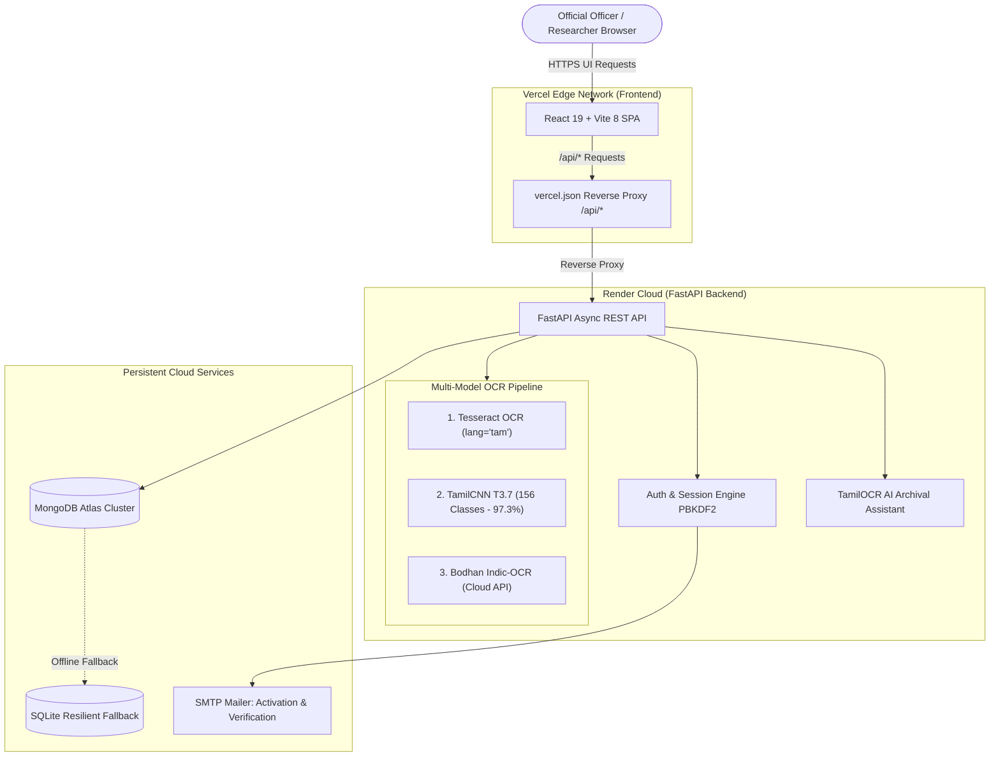
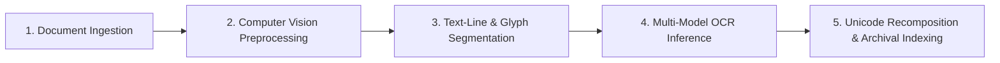

# TamilOCR (தமிழ்OCR) — Handwritten Script Recognition System for Government Archives

> **Project Title**: Computer Vision & Deep Learning-Based Handwritten Tamil Script Recognition System for Digitizing Legacy Government Records  
> **Version**: 2.4.0  
> **Domain**: Digital Governance, Historical Archives Preservation & Document AI  
> **Live Production Portal**: [https://tamilocr-tau.vercel.app](https://tamilocr-tau.vercel.app)  
> **Backend API Gateway**: [https://tamil-ocr-ymob.onrender.com](https://tamil-ocr-ymob.onrender.com)  

---

## 1. System Overview

**TamilOCR** is an enterprise-grade full-stack computer vision and deep learning platform built to digitize, transcribe, search, and preserve legacy Tamil handwritten government documents, land records (*பட்டா / சிட்டா*), revenue deeds, and historical municipal archives.

The system combines advanced OpenCV image preprocessing algorithms with a multi-model OCR engine suite — including a native **Tesseract OCR Engine (`lang='tam'`)**, a specialized Deep Convolutional Neural Network (**TamilCNN / T3.7 Indic Recognition Architecture**) trained on 156 standardized Tamil glyph classes (**97.30% Top-1 validation accuracy**), and **Bodhan Indic-OCR**.

---

## 2. Live Cloud Deployment Architecture



---

## 3. Technology Stack

### Frontend
- **Framework**: React 19 + TypeScript + JSX
- **Build Tool & Bundler**: Vite 8 with `@vitejs/plugin-react`
- **Styling**: Tailwind CSS v4 via `@tailwindcss/vite`
- **Routing**: React Router DOM v7 (Clean SPA routing with `vercel.json` rewrites)
- **Icons**: Lucide React
- **Hosting**: Vercel Edge Network

### Backend & Machine Learning
- **Framework**: FastAPI 0.115+ (Asynchronous ASGI REST API)
- **ASGI Server**: Uvicorn 0.30+
- **Deep Learning**: PyTorch 2.2+ (CPU & CUDA compatible with memory-safe chunked batching)
- **Computer Vision**: OpenCV (`opencv-python` 4.10+), Pillow (`PIL`), NumPy
- **OCR Engines**:
  - `pytesseract` with Tamil Language Pack (`tam.traineddata`)
  - Standalone `TamilCNN` 4-ConvBlock 156-class classifier
  - Bodhan Indic-OCR Cloud Service
- **Language & Post-Processing**: Open-Tamil 1.1+, Python standard `unicodedata` (Canonical NFC Normalization)
- **Database**: Dual Engine — **MongoDB Atlas** (`pymongo`, `dnspython`) with automated local **SQLite 3** fallback (`aiosqlite`)
- **Hosting**: Render Cloud (Linux / Python 3.12)

---

## 4. End-to-End OCR Processing Workflow

The digitization pipeline processes handwritten records through 5 robust stages:



### Stage 1: Document Ingestion
- Accepts high-resolution scans and camera photographs (`.jpg`, `.jpeg`, `.png`, `.webp`, `.tiff`, `.bmp`) up to 15 MB.
- Stores metadata (Title, Department, Year, District, Category) and persists image in MongoDB Atlas as base64 to guarantee availability across ephemeral cloud container restarts.

### Stage 2: Computer Vision Preprocessing
1. **Adaptive Deskewing**: Estimates skew angle using minimum bounding area moments and applies bilinear rotation correction.
2. **CLAHE Contrast Equalization**: Boosts faint historical ink strokes while suppressing parchment discoloration.
3. **Adaptive Denoising**: Removes speckles and paper grain using fast non-local means (`fastNlMeansDenoising`).
4. **Non-Destructive Binarization**: Dual Otsu thresholding combined with adaptive local Gaussian thresholding.
5. **Dynamic Downscaling**: Caps maximum image dimension at 1600px to maintain high OCR character resolution while staying safely within 512MB RAM constraints on cloud tiers.

### Stage 3: Text-Line & Glyph Segmentation
- **Horizontal Projection Profile (HPP)**: Segments text lines by identifying inter-line spacing valleys.
- **Diacritic-Aware Component Grouping**: Merges floating dots (*புள்ளி*), secondary vowel signs (*கொம்பு, கால்*), and ligatures with base consonants to prevent fragmented recognition.

### Stage 4: Multi-Model OCR Inference
- **Primary Engine**: **Tesseract OCR (lang='tam')** with LSTM neural net models.
- **Secondary Engine**: **TamilCNN (T3.7 Indic Recognition Architecture)**:
  - 4 Conv2d blocks (32, 64, 128, 256 filters) with BatchNorm, ReLU, and MaxPool.
  - Linear classifier with Dropout (`p=0.5`).
  - Pretrained on 156 Tamil character classes with **97.30% Top-1 validation accuracy**.
  - **Memory-Safe Batching**: Infers character patches in batches of 32 with explicit tensor cleanup to eliminate memory exhaustion.
- **Third Engine**: **Bodhan Indic-OCR** for cloud-assisted comparison.
- **Resilient Fallback**: If the host environment lacks system Tesseract binaries, the system automatically routes documents through TamilCNN without returning blank text.

### Stage 5: Unicode Recomposition & Archival Indexing
- **Logical Recomposition**: Reconstructs valid Tamil Unicode glyph sequences (e.g. *ஒற்றைக் கொம்பு* `ெ` + consonant + *கால்* `ா` into `ொ`).
- **Canonical Normalization**: Standardizes text to Unicode NFC format.
- **Database Indexing**: Records OCR results, word/character counts, confidence ratings, and bounding boxes in MongoDB Atlas for instant full-text search.

---

## 5. Authentication & Security Engine

TamilOCR implements secure government-grade access controls:

- **Email-Based Officer Registration**:
  - Validates legal name, department, official email, and password.
  - Sends verification emails via SMTP with 24-hour cryptographic URL tokens.
  - Accounts remain `pending_verification` until activated via verification link.
- **Secure Password Hashing**: Salted PBKDF2 with SHA-256 (310,000 iterations).
- **Google Cloud OAuth 2.0**: Direct Google Identity Services authorization code exchange with replay protection.
- **Session Security**: Cryptographically secure bearer tokens with configurable expiration (30 days for "Remember Me", 2 days for standard sessions).
- **Graceful Unconfigured Mode**: If SMTP credentials are not present in `.env`, the system provides testing verification links with diagnostic instructions instead of failing silently.

---

## 6. Project Directory Structure

```text
TamilOCR Web Application/
├── backend/
│   ├── app/
│   │   ├── api/                     # REST API Route Handlers
│   │   │   ├── routes_auth.py       # Authentication, registration, email verify, password reset
│   │   │   ├── routes_chat.py       # Archival AI Assistant chat endpoints
│   │   │   ├── routes_dashboard.py  # Portal statistics & aggregation
│   │   │   ├── routes_health.py     # Liveness, readiness & database diagnostic status
│   │   │   ├── routes_history.py    # Paginated archive CRUD operations & export
│   │   │   └── routes_ocr.py        # Upload, multi-model OCR processing & batch inference
│   │   ├── models/                  # OCR Engine implementations
│   │   │   ├── bodhan_ocr_engine.py # Bodhan Indic-OCR client
│   │   │   ├── indic_ocr_engine.py  # Indic OCR adapter
│   │   │   ├── ocr_engine.py        # End-to-end TamilCNN inference coordinator
│   │   │   ├── t37_model.py         # PyTorch TamilCNN architecture & model loader
│   │   │   ├── tamil_charset.py     # 156 standardized Tamil character classes
│   │   │   └── tesseract_engine.py  # Cross-platform Tesseract engine with CNN fallback
│   │   ├── services/
│   │   │   ├── chat_service.py      # Domain AI assistant service
│   │   │   ├── email_service.py     # SMTP verification & notification engine
│   │   │   └── preprocessing.py     # OpenCV deskew, CLAHE, denoising & line segmentation
│   │   ├── config.py                # Environment configuration loader
│   │   ├── database.py              # MongoDB Atlas + SQLite dual persistence engine
│   │   └── main.py                  # FastAPI application entrypoint & CORS middleware
│   ├── checkpoints/                 # Pretrained neural network weights
│   │   └── tamil_best.pth           # 97.30% val acc checkpoint
│   ├── data/                        # Uploads directory and dataset tools
│   ├── tessdata/                    # Tamil traineddata language pack
│   │   └── tam.traineddata          # Official Tesseract Tamil language model
│   ├── Dockerfile                   # Production Docker container for Render / Cloud
│   └── requirements.txt             # Python runtime dependencies
├── frontend/
│   └── src/
│       ├── api/
│       │   ├── authApi.js           # Authentication API client with 45s cloud timeout
│       │   └── ocrApi.js            # OCR API client with reverse proxy & Render fallback
│       ├── components/              # UI components (Sidebar, Navbar, AIAssistant, Viewer)
│       ├── context/                 # AuthContext, ThemeContext, LanguageContext
│       └── pages/                   # Application pages
│           ├── LandingPage.jsx      # Portal homepage with heritage theme
│           ├── Login.jsx            # Sign-in with Email & Google OAuth
│           ├── Register.jsx         # Officer registration & SMTP diagnostic screen
│           ├── VerifyEmail.jsx      # Email token verification & activation
│           ├── Dashboard.jsx        # Digitization overview & statistics
│           ├── DocumentUpload.jsx   # Document upload & metadata assignment
│           ├── OCRProcessing.jsx    # Live 4-stage pipeline tracker
│           ├── RecognitionResults.jsx # Recognized Tamil text inspection & export
│           ├── DigitizedRecords.jsx # Historical archive with search & filtering
│           └── Settings.jsx         # Engine settings & model comparison
├── render.yaml                      # Render Blueprint deployment definition
├── vercel.json                      # Vercel reverse proxy & SPA routing rewrites
└── package.json                     # Root Vite & NPM workspace configuration
```

---

## 7. REST API Reference

| Method | Endpoint | Description |
| :--- | :--- | :--- |
| `GET` | `/api/health` | Service liveness, loaded OCR model, and MongoDB Atlas connectivity status. |
| `POST` | `/api/auth/register` | Register an officer account, hash password with PBKDF2, generate verification token, and send activation email. |
| `POST` | `/api/auth/login` | Authenticate officer credentials and issue session bearer token. |
| `POST` | `/api/auth/verify-email` | Validate cryptographic token and activate account. |
| `POST` | `/api/auth/resend-verification` | Generate new activation token and resend verification email. |
| `POST` | `/api/auth/forgot-password` | Generate password reset token. |
| `POST` | `/api/auth/reset-password` | Set new password with valid reset token. |
| `POST` | `/api/documents/upload` | Upload manuscript scan, validate dimensions, and persist in database. |
| `POST` | `/api/documents/{id}/process-ocr` | Run OCR using selected model (**Tesseract**, **TamilCNN**, or **Indic-OCR**) and save recognized text. |
| `GET` | `/api/dashboard/stats` | Aggregate digitization counts, monthly timeline, and confidence distributions. |
| `GET` | `/api/history` | Paginated search of digitized records with department/district filters. |
| `POST` | `/api/chat` | AI Archival Assistant query with domain knowledge and conversational history. |

---

## 8. Deployment Guide

### Deploying Backend on Render
1. Create a new **Web Service** on [render.com](https://render.com).
2. Connect your repository (`Tamil-OCR`).
3. Set the following build settings:
   - **Environment**: `Python 3`
   - **Root Directory**: `backend`
   - **Build Command**:
     ```bash
     pip install --upgrade pip && pip install torch torchvision --index-url https://download.pytorch.org/whl/cpu && pip install -r requirements.txt
     ```
   - **Start Command**:
     ```bash
     uvicorn app.main:app --host 0.0.0.0 --port $PORT
     ```
4. Add Environment Variables:
   - `PYTHON_VERSION`: `3.12.0`
   - `MONGODB_URI`: `mongodb+srv://...`
   - `MONGODB_DB_NAME`: `tamilocr_db`
   - `CORS_ORIGINS`: `*`
   - `DEVICE`: `cpu`
   - `CONFIDENCE_THRESHOLD`: `80.0`

### Deploying Frontend on Vercel
1. Import repository on [vercel.com](https://vercel.com).
2. Set **Framework Preset** to `Vite`.
3. The included [`vercel.json`](file:///c:/Users/Nithish/Downloads/TamilOCR%20Web%20Application/vercel.json) automatically proxies all `/api/*` requests directly to your Render backend:
   ```json
   {
     "rewrites": [
       {
         "source": "/api/:path*",
         "destination": "https://tamil-ocr-ymob.onrender.com/api/:path*"
       },
       {
         "source": "/(.*)",
         "destination": "/index.html"
       }
     ]
   }
   ```
4. Click **Deploy**. Vercel will build and serve the application globally.

---

## 9. Local Development Setup

### 1. Prerequisites
- Python 3.10, 3.11, or 3.12
- Node.js 18+ and npm / pnpm
- Git

### 2. Backend Setup
```bash
cd backend
python -m venv venv
# Windows:
venv\Scripts\activate
# Linux/macOS:
source venv/bin/activate

pip install -r requirements.txt
uvicorn app.main:app --host 0.0.0.0 --port 8000 --reload
```

### 3. Frontend Setup
```bash
# In project root:
npm install
npm run dev
```

The frontend will start on `http://localhost:3000` with hot module replacement and automatic proxying to backend port 8000.

---

## 10. License & Credits

- **Project Lead**: TamilOCR Engineering Team
- **Benchmark Dataset**: HP-uTHCD (Handwritten Tamil Character Dataset)
- **Deep CNN Architecture**: T3.7 Indic Recognition Architecture (`dhruv10050/t3-7-indic-recognition`)
- **License**: MIT License — open for academic, cultural heritage, and administrative governance use.